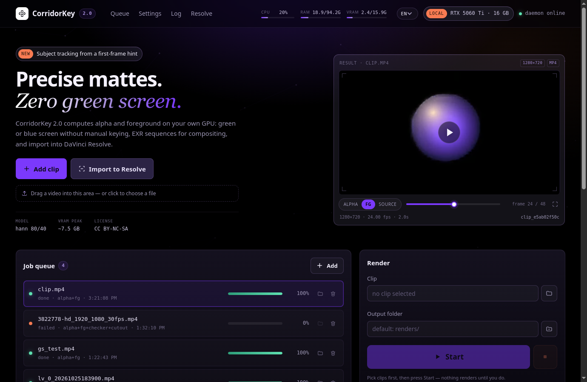

# CorridorKey 2.0 — Linux desktop shell

A native Linux front-end for the free **CorridorKey 2.0** matting model: drag a clip, hit
**Start**, watch it keying live, then scrub alpha / foreground frame by frame — all on your
own GPU, no green screen and no cloud.

> Unofficial wrapper. The model and inference engine are made by **Corridor Digital** and
> **Zachary Harris** — see [NOTICE.md](NOTICE.md) and [LICENSE](LICENSE).


## What it does

- **Queue, not casino.** Pick or drop clips, choose an output folder, press the big **Start**.
  Nothing renders until you say so.
- **Live preview while it renders** — the panel shows the frame the model is working on.
- **Player for the result** — alpha / foreground / source toggle, frame-accurate scrubbing,
  fullscreen (with a fallback "cinema" mode if the browser refuses the Fullscreen API).
- **Resource meters** — CPU, RAM and VRAM in the header, straight from `/proc` and `nvidia-smi`.
- **EN / RU interface** (English by default).
- **Resolve hand-off** — finished jobs are imported into the media pool through the official
  Scripting API when Resolve is running with *External scripting = Local*.
- **Dark, quiet UI** built as a local web app inside a Qt window, so the same interface opens
  in any browser at `http://127.0.0.1:8129/`.

## Requirements

| | |
|---|---|
| GPU | NVIDIA RTX 30-series or newer (≥4 GB VRAM for ≤1440p, ≥6 GB for 4K) |
| Driver | CUDA 12.8 capable |
| System | Linux with `ffmpeg` / `ffprobe`, Python 3.10+ |
| Disk | ~6 GB for the environment and model weights |

## Install

```bash
git clone https://github.com/<you>/corridorkey-linux.git
cd corridorkey-linux
./setup.sh          # venv, PySide6 + FastAPI, upstream engine, torch cu128, weights (~5 GB)
./run.sh            # starts the local daemon and the window
```

`setup.sh` clones [nikopueringer/CorridorKey2.0](https://github.com/nikopueringer/CorridorKey2.0)
and pulls the weights from Hugging Face; the engine is never bundled here.

<details>
<summary>Manual install</summary>

```bash
python3 -m venv .venv && source .venv/bin/activate
pip install -r requirements.txt
git clone --depth 1 https://github.com/nikopueringer/CorridorKey2.0.git
pip install torch==2.9.1 torchvision==0.24.1 --index-url https://download.pytorch.org/whl/cu128
pip install -r CorridorKey2.0/requirements.txt
(cd CorridorKey2.0 && python scripts/download_weights.py)
./run.sh
```
</details>

## Use it

1. **Clip** — `+ Add clip`, the dashed drop zone in the hero, or drag a file anywhere onto the
   window. Files land in a pending list; nothing is queued yet.
2. **Hint** (this is the important one) — a black-and-white PNG matte of the subject on **frame 1**.
   The model tracks from it. Without a hint the matte can lock onto the background instead of your
   subject, and the UI warns you about it. Even a rough hand-painted matte works well.
3. **Outputs** — `alpha + fg` (default) or `alpha + fg + checker + cutout`. Turn on **EXR linear**
   if you want image sequences for compositing instead of preview videos.
4. **Output folder** — optional; results go to `<folder>/<clip>_<jobid>/`, default `renders/`.
5. **Start** — everything in the pending list is queued. The preview switches to live frames;
   **Stop** cancels the running job.
6. **Result** — the panel turns into a player. `Alpha` is the matte, `FG` the despilled
   foreground, `Source` the original plate; drag the timeline to any frame.
7. **Queue rows** — ✕ cancels a running job, the trash icon removes a finished one from the
   queue and the manifest (rendered files stay on disk).



## Performance

Measured on an RTX 5060 Ti 16 GB, auto windowing (Hann chunk/stride picked by VRAM):

| Input | Frames | Time | Per frame |
|---|---|---|---|
| 1080×1920, 30 fps | 1559 (52 s) | ~33 min | ~1.3 s |
| 1280×720, 24 fps | 48 (2 s) | ~40 s incl. model load | — |

Model load is ~15 s per job. Use **Frames (test)** to render a short slice first — it is the
fastest way to check a hint before committing to a full shot.

## HTTP API

The window talks to a local daemon on `127.0.0.1:8129`, so the whole thing is scriptable:

| Method | Path | Purpose |
|---|---|---|
| `POST` | `/jobs` | queue a job (`input`, `hint_first_frame`, `outputs`, `num_frames`, `despill`, `exr`, `low_vram`, `output_dir`) |
| `GET` | `/jobs` | queue with status/progress/log tail |
| `POST` | `/jobs/{id}/cancel` | stop a job |
| `DELETE` | `/jobs/{id}` | drop it from the queue and manifest |
| `GET` | `/jobs/{id}/frame?kind=source\|alpha\|fg&t=12.5` | JPEG frame, for live preview |
| `GET` | `/jobs/{id}/result` | result metadata + media URLs |
| `GET` | `/jobs/{id}/preview?kind=fg` | WebM preview (see troubleshooting) |
| `GET` | `/stats` | CPU / RAM / GPU snapshot |

```bash
curl -X POST http://127.0.0.1:8129/jobs -H 'Content-Type: application/json' -d '{
  "input": "/abs/path/shot.mp4",
  "hint_first_frame": "/abs/path/matte_0001.png",
  "outputs": ["alpha", "fg"]
}'
```


## Troubleshooting

**The player shows a still frame instead of playing.** This Chromium build ships without H.264,
so mp4 cannot be decoded in `<video>`. The daemon transcodes results to WebM/VP9 on demand
(720p, cached next to the render) — the badge shows *preparing preview … %* the first time.

**Nothing happens after Start.** Check the log card: the usual culprits are a missing hint file,
an input that ffmpeg cannot read, or an out-of-VRAM window size. Low VRAM mode helps on small cards.

**The matte drifts into the background.** The hint was too weak or wrong: redo it for frame 1 with
the subject filled white, everything else black, and keep *Hint quality* at 0.9–0.95.

**File dialog looks odd / black.** The dialog is styled for this app; if your Qt theme fights it,
set `QT_QPA_PLATFORMTHEME=` (empty) before launching.

## Licence

The wrapper follows the upstream licence: **CC BY-NC-SA 4.0 with additional terms** — free to use,
including commercially for your own footage, but no reselling or repackaging, no paid API, forks must
stay free and keep the CorridorKey name. Full text in [LICENSE](LICENSE).

## Credits

- Model and engine: [Corridor Digital LLC](https://corridorkey.com) / Zachary Harris,
  repository [nikopueringer/CorridorKey2.0](https://github.com/nikopueringer/CorridorKey2.0),
  weights [on Hugging Face](https://huggingface.co/nikopueringer/CorridorKey2.0).
- Desktop shell: this repository (PySide6 + FastAPI, no telemetry, runs fully offline).
